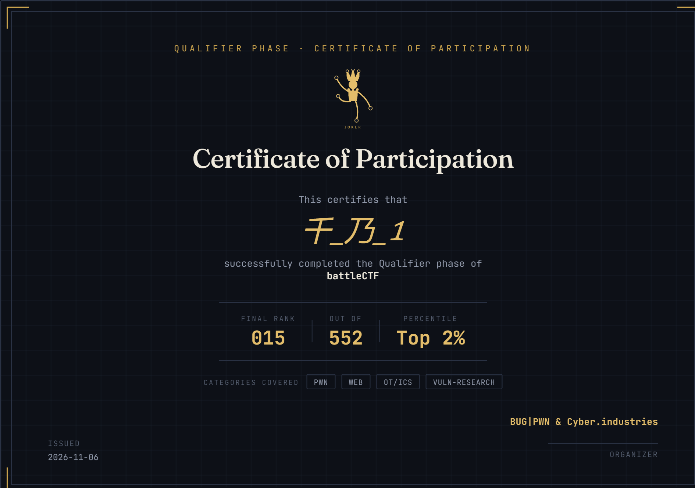
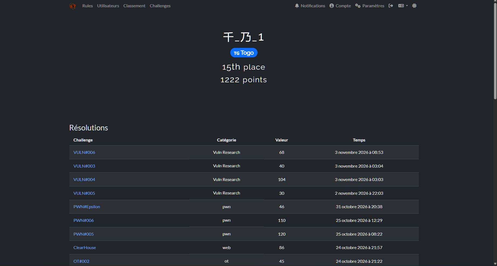

**15ème place sur 552** à la **phase qualificative du battleCTF**, soit le **Top 2 %**, avec **1222 points**.

- **Classement final :** 15 / 552 (Top 2 %)
- **Points :** 1222
- **Catégories :** PWN, Web, OT/ICS, Vuln Research
- **Organisateur :** BUG\|PWN & Cyber.industries
- **Date :** 6 novembre 2026

Mes write-ups des challenges (Web, Pwn, OT/ICS, Vuln Research, Out Context) sont sur GitHub : [F3nD1x/BattleCTF-writeup](https://github.com/F3nD1x/BattleCTF-writeup).

_Certificat de participation, phase qualificative_

_Profil sur la plateforme : 15ème place, 1222 points_
